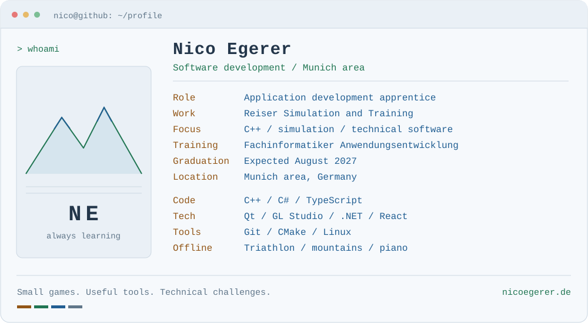

<picture>
  <source media="(prefers-color-scheme: dark)" srcset="profile-dark.svg">
  <source media="(prefers-color-scheme: light)" srcset="profile-light.svg">
  
</picture>

  <a href="https://nicoegerer.de">Portfolio</a> &nbsp; / &nbsp;
  <a href="https://www.linkedin.com/in/nico-egerer/">LinkedIn</a> &nbsp; / &nbsp;
  <a href="mailto:GitHub@nicoegerer.de">Contact</a>

### About me

I'm training as a **Fachinformatiker für Anwendungsentwicklung** (application development specialist) at **Reiser Simulation and Training**, with graduation expected in August 2027. I'm particularly interested in **C++, simulation and technical applications**. My current work includes cockpit control panels with C++, Qt and GL Studio.

I learn by building small games, desktop tools and web applications. Outside of code, you'll usually find me training for triathlon, in the mountains or at the piano.

### Selected projects

| Project | What I'm building | Explore |
| --- | --- | --- |
| **JumpJump** | A C++ platformer using raylib, compiled to WebAssembly with Emscripten. | [Play in your browser](https://jumpjump.nicoegerer.de/) |
| **Image Converter** | A C# / .NET desktop app for editing, renaming and exporting images locally. | [Project overview](https://nicoegerer.de/projects/) |
| **GarminTool** | A training dashboard for visualizing Garmin activities, built with Next.js, React and TypeScript. | [Project overview](https://nicoegerer.de/projects/) |
| **ChargeRoute** · in progress | A team school project for EV route and charging-stop planning with React and TypeScript. | [Project overview](https://nicoegerer.de/projects/) |

**Open source:** [WebUI Workbench](https://github.com/nicoegerer/webui-workbench) is my extended fork of Open WebUI Desktop, with additional integrations, GitHub workspaces and local website previews.

Profil auf Deutsch

Ich bin Nico und mache bei Reiser Simulation and Training eine Ausbildung zum **Fachinformatiker für Anwendungsentwicklung**. Mein Abschluss ist voraussichtlich im August 2027. Besonders interessieren mich **C++, Simulation und technische Software**. In der Ausbildung arbeite ich unter anderem an Cockpit-Bedienpanels mit C++, Qt und GL Studio.

In eigenen Projekten entwickle ich kleine Spiele, Desktop-Werkzeuge und Webanwendungen. Dabei möchte ich meine Kenntnisse Schritt für Schritt vertiefen. Neben dem Programmieren begeistere ich mich für Triathlon, Bergsport und Klavierspielen.

Projektbeschreibungen und eine spielbare Version von JumpJump findest du auf [meiner Website](https://nicoegerer.de/projects/).

